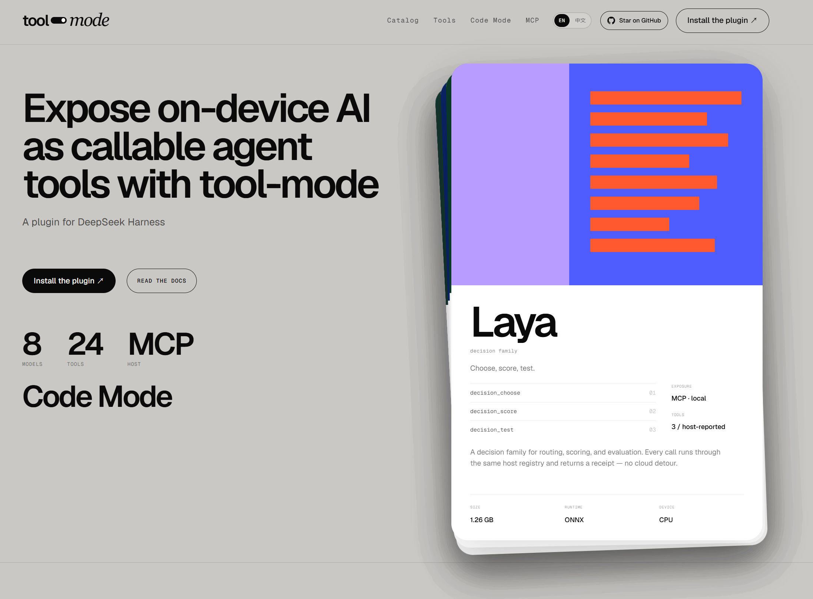
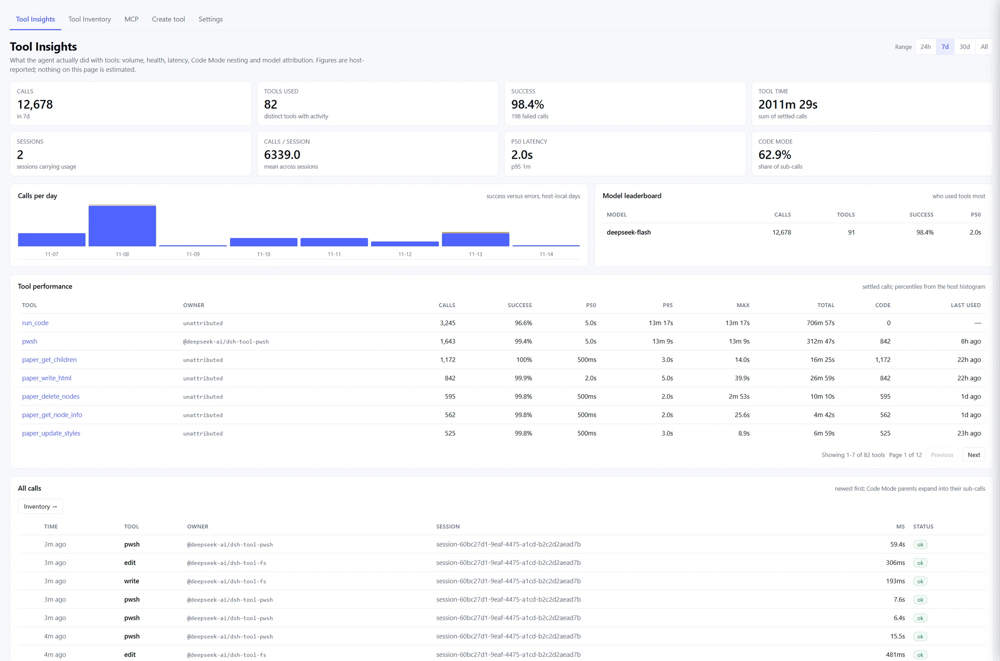

# Tool Mode

**Give your DSH agent real tools for the models on your machine.**

[](https://www.npmjs.com/package/@try-works/dsh-tool-mode)
[](LICENSE)

Tool Mode turns local and on-device models into typed tools that an agent can
actually call. Instead of pretending a model is a chat endpoint, it registers
tools such as `lang_detect`, `stt_transcribe`, `semantic_rank` and
`structured_extract`, with explicit input/output schemas and an honest answer for
every model that cannot run on this machine.



*Tool Mode: expose on-device AI as callable agent tools.*

> **New to Tool Mode?** Start with the
> **[documentation](dsh-tool-mode/docs/guide/index.md)** → installation takes a
> few minutes.

## Why Tool Mode

- **Tools, not model names.** The agent asks for `lang_detect`; which model or
  route serves it is a deployment decision. Swapping the model does not change
  the tool schema.
- **Capability-aware.** A model is registered only when it can run here, or is
  deliberately exposed as unavailable with the reason. No tool that fails on
  every call.
- **Local-first.** Models can run in-process, through the Desert Ant CLI, through
  a user-hosted bridge, or as an installed extension.
- **Remote Jev when you want it.** The optional Jev typed-question API adds
  remote decision tools; it is explicitly opt-in and is not a local checkpoint.
- **One surface for agents and MCP.** The same tools are available to DSH and to
  MCP clients over an authenticated loopback endpoint.
- **Operable.** Model toggles, extensions, custom tools, usage insights and
  security controls live in DSH settings.



*Tool Insights: usage, latency, success and model attribution for every tool.*

## Install

Tool Mode is a DSH bundle. Install it into a profile:

```sh
dsh plugin --profile web add @try-works/dsh-tool-mode
```

Restart DSH, then open **Settings → Tool Mode**. Enable a model — **Tongue** is
the simplest first choice because its 2 MB model ships inside the npm package and
needs no runtime download.

Ask the agent:

> Detect the language of “Bonjour, comment allez-vous ?”

It calls `lang_detect` and returns the language with confidence and ranked
alternatives.

Full instructions, manual installs and upgrade notes are in
[Installation](dsh-tool-mode/docs/guide/getting-started/installation.md).

## Models

Tool Mode ships with the **18-model Desert Ant catalog**. The first-party
extensions below add more models and tools; Tongue and Voz appear in both lists
because they are catalog models with first-party implementations. Availability
depends on the platform, installed runtimes, prepared assets and enabled
extensions.

### Desert Ant catalog

| Model | Task | Windows x64 |
| --- | --- | --- |
| Align | Audio word alignment | Browser-only SDK |
| Clear | Speech enhancement | Browser-only SDK |
| Clips | Video clip selection | Browser-only SDK |
| Ear | Spoken-language identification | Browser-only SDK |
| Emo | Emoji suggestion | Browser-only SDK |
| Eye | Image frame scoring | Closed beta |
| Face | Face matching | Closed beta |
| Gist | Topic tagging | Browser-only SDK |
| Moderator | NSFW detection | Browser-only SDK |
| Redact | PII redaction | Browser-only SDK |
| Schemer | Structured extraction | Closed beta |
| Shapes | Stroke shape recognition | Browser-only SDK |
| Title | Title generation | Apple only |
| Tongue | Language detection | **Yes** — pure JavaScript, weights bundled |
| Toxic | Toxicity detection | Closed beta |
| Uhm | Filler detection | Apple only |
| Voz | Speech-to-text | **Yes** — ONNX Runtime, ~367 MB weights on first use |
| Who | Speaker labeling | Closed beta |

### Extension models

| Model | Tools | Notes |
| --- | --- | --- |
| Laya decision family | `decision_choose`, `decision_choose_local`, `decision_score`, `decision_score_typed`, `decision_test`, `decision_test_typed` | Local decision checkpoint |
| EmbeddingGemma 2 | `multimodal_embed`, `semantic_similarity`, `semantic_rank`, `semantic_classify`, `semantic_deduplicate`, `dedupe_and_rank`, `media_find_moments` | Text, image and audio embeddings |
| MiniLM embed | `text_embed` | 384-dimensional compatibility space |
| MiniLM rerank | `text_rerank` | Cross-encoder ranking |
| Cactus Needle 3 | `structured_extract`, `extract_with_repair`, `validate_record`, `tools_plan` | Structured extraction and tool planning |
| Cactus Mirage | `mirage_describe`, `mirage_detect`, `mirage_ocr`, `mirage_extract` | Vision: describe, detect, OCR, forms |
| Harness Vision | `describe_image` | Image description through an authorized harness model |
| Harness Text Tools | `text_title` | Title and summary generation |
| Declarative recipes | Recipe-defined tools | Harness-model-backed recipes |

Use `tool_mode_list` for the live answer in your process. The complete table,
per-model details and the reason for every unavailable model are in
[Models](dsh-tool-mode/docs/guide/reference/models.md).

## Tools

The **current tool surface** is grouped below. Exact availability depends on
installed extensions, enabled models and the caller's grant; use
`tool_mode_list` for the live list and `tool_mode_describe` for schemas.

### Language, audio and embeddings

| Tool | Backed by |
| --- | --- |
| `lang_detect` | Tongue |
| `stt_transcribe` | Voz |
| `text_embed` | MiniLM embed |
| `text_rerank` | MiniLM rerank |
| `multimodal_embed` | EmbeddingGemma 2 |
| `semantic_similarity` | EmbeddingGemma 2 |
| `semantic_rank` | EmbeddingGemma 2 |
| `semantic_classify` | EmbeddingGemma 2 |
| `semantic_deduplicate` | EmbeddingGemma 2 |
| `dedupe_and_rank` | EmbeddingGemma 2 |
| `media_find_moments` | EmbeddingGemma 2 |

### Vision and structured work

| Tool | Backed by |
| --- | --- |
| `describe_image` | Harness Vision |
| `mirage_describe` | Cactus Mirage |
| `mirage_detect` | Cactus Mirage |
| `mirage_ocr` | Cactus Mirage |
| `mirage_extract` | Cactus Mirage |
| `structured_extract` | Cactus Needle 3 |
| `extract_with_repair` | Cactus Needle 3 |
| `validate_record` | Cactus Needle 3 |
| `tools_plan` | Cactus Needle 3 |
| `text_title` | Harness Text Tools |

### Decisions

| Tool | Backed by |
| --- | --- |
| `decision_choose` | Laya |
| `decision_choose_local` | Laya |
| `decision_score` | Laya |
| `decision_score_typed` | Laya |
| `decision_test` | Laya |
| `decision_test_typed` | Laya |
| `decision_combine` | Host |
| `decision_evaluate` | Host |
| `decision_route` | Host |
| `decision_choose_jev` | Remote Jev API (opt-in) |
| `decision_judgments_jev` | Remote Jev API (opt-in) |

### Discovery, management and Code Mode

| Tool | Purpose |
| --- | --- |
| `tool_mode_list` | Live tool catalogue, readiness and catalog revision |
| `tool_mode_describe` | Schemas, semantics, limits and unsupported cases |
| `model_tools` | Host-local model and extension management view |
| `tool_mode_run` | Bounded multi-tool program; only when Code Mode is released |

Full descriptions and schemas: [Tool reference](dsh-tool-mode/docs/guide/reference/tools.md).

## Remote Jev (optional)

Tool Mode also supports **Jev**, TypeSafe's remote System One typed-question API.
Jev is not a local model and has no local weights: enabling it adds a deliberate
network route for decision tasks.

```yaml
- id: model-tools
  config:
    jev:
      enabled: true
      model: jev-1.14
      # apiKey: ...                 # direct operator config
      # credentialRef: jev/api-key  # DSH credentials service (default)
      # apiKeyEnv: TYPESAFE_API_KEY # environment fallback
```

When enabled, it registers:

- `decision_choose_jev` — choose one of 2–16 options through Jev.
- `decision_judgments_jev` — batch independent yes/no judgments through Jev.

The API key is resolved in this order: `jev.apiKey`, the DSH credential reference
(default `jev/api-key`), then `apiKeyEnv` (default `TYPESAFE_API_KEY`). A missing
key produces a named `JEV_API_KEY_NOT_CONFIGURED` diagnostic; there is no fake
answer and no silent local fallback. Set `baseURL` only if you use a compatible
endpoint other than the default.

Jev is opt-in and network-bound. Leave it disabled for a no-network deployment.
See [Configuration: Jev](dsh-tool-mode/docs/guide/reference/configuration.md#jev).

## Use it from an MCP client

Enable the endpoint in your profile:

```yaml
- id: model-tools
  config:
    mcpV3:
      enabled: true
      host: 127.0.0.1
      port: 3765
      path: /mcp
```

Provide the bearer token through `DSH_TOOL_MODE_MCP_TOKEN` or a `tokenFile`, then
connect Claude Desktop, Cursor or another MCP client. The endpoint serves MCP
`2026-07-28` over loopback HTTP, with per-client grants and tool-level export
policy.

See [Connect an MCP client](dsh-tool-mode/docs/guide/guides/connect-an-mcp-client.md).
For wire behavior, see the
[MCP protocol reference](dsh-tool-mode/docs/guide/reference/mcp-protocol.md).

## What is in this repository

| Folder | Runtime | Status |
| --- | --- | --- |
| [`dsh-tool-mode`](dsh-tool-mode/) | DeepSeek Harness (DSH) | **Available** — plugin, contracts, extension SDK, extensions, tests |
| `opencode-tool-mode` | OpenCode | Planned |
| `pi-tool-mode` | Pi | Planned |

The DSH implementation is a monorepo. The published plugin is
[`@try-works/dsh-tool-mode`](https://www.npmjs.com/package/@try-works/dsh-tool-mode);
the repository also contains the model-free contracts, the public extension SDK,
first-party model extensions, and verification tooling.

## Documentation

| Read this | If you want to… |
| --- | --- |
| [Documentation home](dsh-tool-mode/docs/guide/index.md) | Start at the beginning |
| [Installation](dsh-tool-mode/docs/guide/getting-started/installation.md) | Add the plugin to a profile |
| [First tool](dsh-tool-mode/docs/guide/getting-started/first-tool.md) | Make a first successful call |
| [Using tools in DSH](dsh-tool-mode/docs/guide/guides/using-tools-in-dsh.md) | Day-to-day use with an agent |
| [Extensions](dsh-tool-mode/docs/guide/guides/install-extensions.md) | Add model tools beyond the catalog |
| [Custom tools](dsh-tool-mode/docs/guide/guides/custom-tools.md) | Create HTTP, prompt or composite tools |
| [Security](dsh-tool-mode/docs/guide/guides/security-and-permissions.md) | Understand tokens, grants and approvals |
| [Troubleshooting](dsh-tool-mode/docs/guide/help/troubleshooting.md) | Diagnose a missing tool or MCP problem |
| [Tool reference](dsh-tool-mode/docs/guide/reference/tools.md) | See every tool and its backing model |
| [Configuration](dsh-tool-mode/docs/guide/reference/configuration.md) | Change profile behavior |

## Requirements

- Node.js **24+**
- DSH **0.2.1-rc.2+**
- A supported platform for the model you want to run

The plugin starts cleanly without model runtimes; it reports what is missing
rather than failing at call time.

## Development

The DSH monorepo lives in [`dsh-tool-mode`](dsh-tool-mode/). Build, test and
verification commands run from there:

```sh
cd dsh-tool-mode
npm ci
npm run link:dsh -- --checkout /path/to/deepseek-harness
npm run build
npm test
npm run verify
```

`link:dsh` is required for local development because the DSH peer packages are
supplied by a DSH checkout rather than installed by npm.

Useful references:

- [Package README](dsh-tool-mode/README.md)
- [Extension authoring and contracts](dsh-tool-mode/docs/PLUGIN.md)
- [Internal specifications and evidence](dsh-tool-mode/docs/) — engineering
  material, not user documentation

## License

Apache License 2.0. See [LICENSE](LICENSE).

Model weights and SDKs keep their own vendor licenses; Tool Mode does not
redistribute model weights. See the model pages for the applicable terms.
